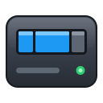
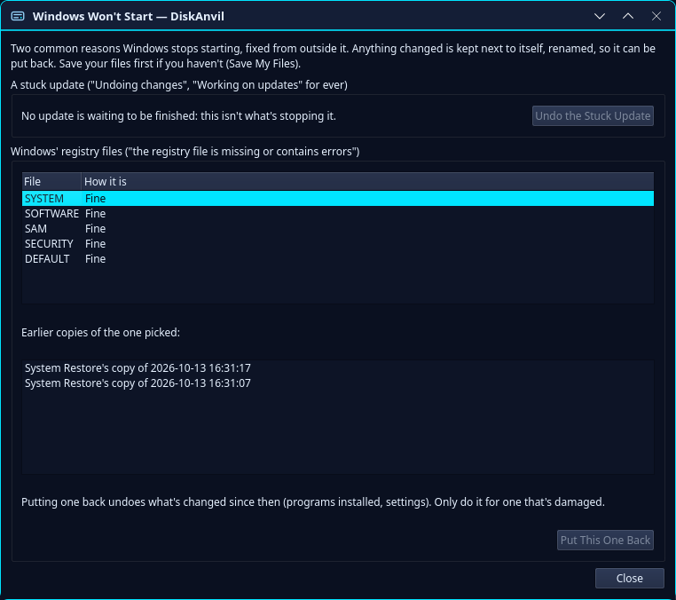
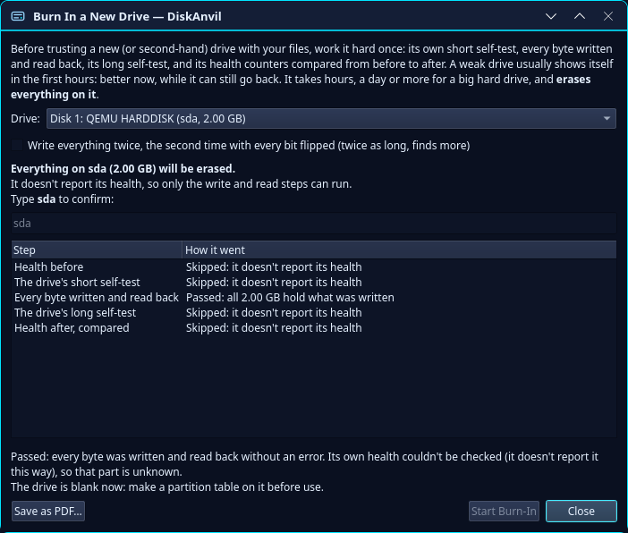
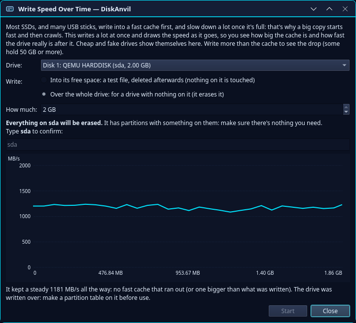
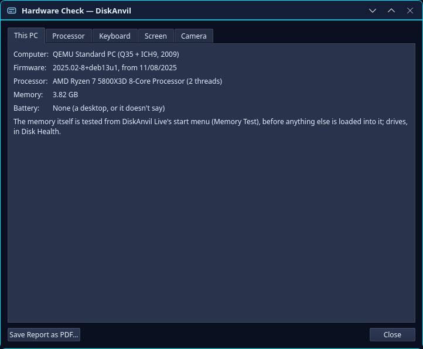
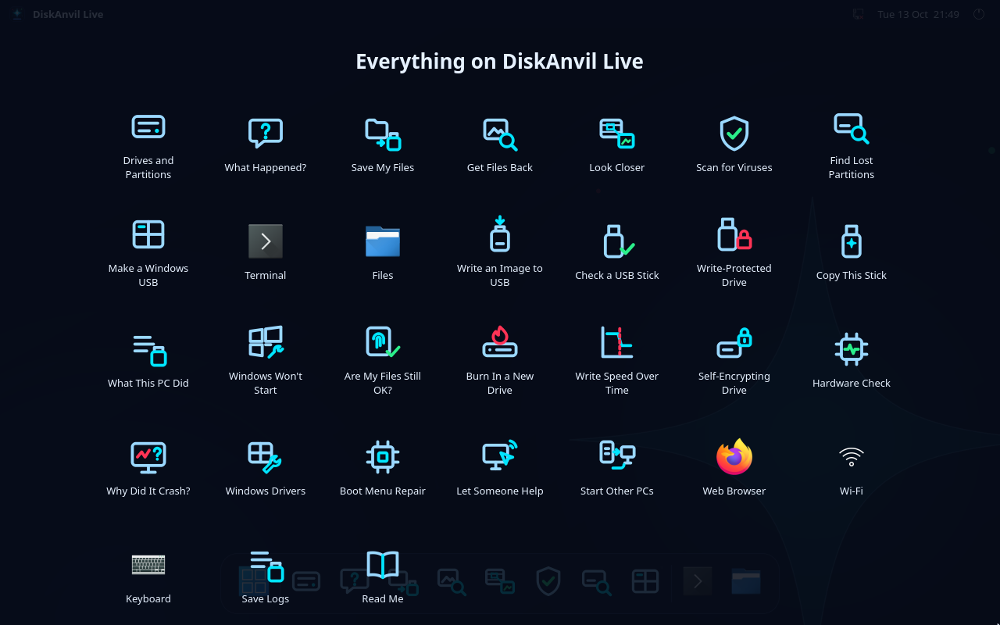

<p align="center">
  
</p>
<h1 align="center">DiskAnvil</h1>
<p align="center">
  A disk manager for Linux and Windows that works like Windows Disk Management,<br>
  plus a rescue USB stick that starts any PC and fixes its drives.
</p>
<p align="center">
  <a href="https://github.com/DannyS124/diskanvil/releases/latest"></a>
  
  <a href="LICENSE"></a>
</p>
<p align="center">
  <a href="#download">Download</a> ·
  <a href="#what-it-does">What it does</a> ·
  <a href="#diskanvil-live">DiskAnvil Live</a> ·
  <a href="#how-do-i">How do I...</a> ·
  <a href="#support">Support</a>
</p>

I've been on Arch for a while and wanted something simple for managing drives without going to the terminal, so I
made this. It does the everyday jobs (formatting, partitions, mounting) and the ones you need when something has gone
wrong: a drive that's dying, a stick that's fake, files that are gone, a Windows that won't start.

It never runs as root on Linux. Changes go through udisks2 with the usual password prompt, and the drive your system
runs from is locked, so you can't format it by accident. It runs on Windows too, and on its own USB stick.

DiskAnvil was called DiskForge up to version 0.5.1. Same program, new name; your settings move over by themselves.

## Support

DiskAnvil is free and it's staying free. If it got your files back or saved you a trip to the computer shop and you
want to say thanks, you can buy me a coffee on Ko-fi. It helps me keep working on it.

[](https://ko-fi.com/K0C528JI83)

## Download

Everything is on the [Releases page](https://github.com/DannyS124/diskanvil/releases/latest).

| For | Get | Notes |
|---|---|---|
| Arch | the PKGBUILD in this repository | see [Arch](#arch) below |
| Other Linux | `DiskAnvil-x86_64.AppImage` or `DiskAnvil-x86_64.flatpak` | a .deb can be built too, see [Other distros](#other-distros) |
| Windows 10 and 11 | `DiskAnvil-<version>.msi` | or the .zip, which runs without installing. See [Windows](#windows) |
| A PC that won't start | `diskanvil-live-<version>.iso` | the rescue stick, see [DiskAnvil Live](#diskanvil-live) |

## What it does

### &nbsp; Drives and partitions

- &nbsp; **Format** as exFAT, FAT32, NTFS, ext4, Btrfs or XFS, with LUKS encryption if you want it
- &nbsp; **Partitions**: create, delete, resize and rename them, set their type and flags, make new GPT or MBR tables
- &nbsp; **Mount, unmount and safely remove**, or have a drive mount every time the PC starts
- &nbsp; **Encryption**: unlock and lock LUKS, BitLocker and VeraCrypt (PIM, keyfiles, hidden and system volumes), change a LUKS passphrase or BitLocker password, and keep a backup of a LUKS header in case it gets damaged
- &nbsp; **Disk images**: open .iso and .img files like a drive
- &nbsp; **NAS drives, RAID, LVM and Windows dynamic disks**: shown with their status, and opened read-only so their files can be copied off
- &nbsp; **Format as an SD Card**, using the SD Association's own layout for the card's size, which cameras expect

| File system | Format | Check and repair | Resize |
|---|:---:|:---:|---|
| ext4 | ✓ | ✓ | grow and shrink (grows while mounted) |
| Btrfs | ✓ | ✓ | grow and shrink, while mounted |
| NTFS | ✓ | basic fixes (chkdsk in Windows for real damage) | grow and shrink, unmounted |
| FAT32 | ✓ | ✓ | grow and shrink, unmounted |
| exFAT | ✓ | ✓ | ✗ |
| XFS | ✓ | ✓ | grow only |

### &nbsp; Drive health and testing

- &nbsp; **Disk Health** reads a drive's own health data (SATA and NVMe) and gives a plain verdict with every reason behind it, based on the numbers Backblaze's drive stats tie to failures. A bar at the top warns you when a drive starts to go
- &nbsp; **What the maker knows**: Seagate's FARM hours next to SMART's (so a wiped history shows), eMMC wear, SMR drives, known firmware bugs, badly aligned partitions, Backblaze's failure rate for the model, and What's That Noise?
- &nbsp; **Scan for Bad Sectors** reads every sector and draws a map. Repair rewrites the unreadable blocks so the drive swaps in spares, and keeps everything around them
- &nbsp; **Self-tests and firmware**: the drive's own short, long and conveyance tests, their history, SMART switched back on, and firmware updates through fwupd
- &nbsp; **Burn In a New Drive**: its self-tests, every byte written and read back, its health compared before and after, then a verdict and a PDF. Worth doing before your files go on a new or second-hand drive
- &nbsp; **Write Speed Over Time** draws the speed while a lot is written, so you see how big an SSD's fast cache is and how slow it gets after it. Cheap and fake drives give themselves away here
- &nbsp; **Benchmark**: read speed on any drive, plus an optional write test
- &nbsp; **Self-Encrypting Drive**: whether a drive encrypts in hardware and is locked. A locked second-hand one can be reset with the PSID printed on its label
- &nbsp; **Drive settings**: power saving, write cache and read-ahead for every SATA drive, spin-down, seek noise and Sleep Now for hard drives. DiskAnvil Live also finds a hidden area (HPA) at the end of a drive and gives the space back
- &nbsp; **Hardware Check**: the rest of the PC. Heat and speed under full load, battery wear, every key on the keyboard, dead pixels and the camera, with a report

### &nbsp; Getting files back

- &nbsp; **What Happened?** starts from what went wrong (deleted, formatted, won't open, clicking, ransomware...) and gives honest odds, what not to do, and which tools to use, in order
- &nbsp; **Find Lost Files** brings deleted files back with their names and folders from FAT, exFAT, NTFS and ext4 (the Recycle Bin too) and from Windows' earlier versions of a drive. After a quick format it still finds the old folders and gives files their names back. When a drive won't open, it finds files by what's inside them. It reads virtual machine disks and backups, and it only ever reads the drive it looks through
- &nbsp; **Look before you save**: a viewer for pictures, PDFs, films, songs and documents, each file's dates and photo details, the damage marked inside a file, Repair a Copy (PNG, JPEG, Office, PDF, SQLite, films without their index), search by words you remember, Windows' thumbnail caches and a timeline
- &nbsp; **Rescue Copy** copies a failing drive to an image file or another drive, easy parts first. It can stop and carry on later, its map works with GNU ddrescue, it can go easy on a hot or struggling drive, and it leaves a dying head's stripes for last. Afterwards it lists which files the bad spots hit
- &nbsp; **Are My Files Still OK?** keeps a fingerprint of every file in a folder and checks them again later, so you know which photos went bad over the years while a good copy still exists
- &nbsp; **Recover Partitions** puts a lost partition table back from GPT's backup copy, from a layout DiskAnvil saw before (it keeps the last 10), or by scanning the drive, and it can be undone

Find Lost Files recognises these by what's inside them:

| Kind | Types |
|---|---|
| Pictures | JPEG, PNG, GIF, BMP, WebP, HEIC, AVIF, TIFF, PSD, SVG, camera raw (CR2, CR3, NEF, ARW, DNG, ORF, RW2...) |
| Documents | PDF, Word, Excel, PowerPoint (the old 97 kinds too), OpenDocument, EPUB, RTF, web pages |
| Video | MP4, MOV, 3GP, AVI, MKV, WebM, WMV, Ogg video |
| Music | MP3, WAV, M4A, FLAC, Ogg, Opus |
| Archives | ZIP, 7-Zip, RAR, gzip, JAR, APK |
| Mail and more | emails (.eml), mailboxes, Outlook files, calendars, contacts, SQLite databases, plain text |

Files found that way get names made up from what's in them. Deleted files that FAT, exFAT or NTFS still remember come
back with their real names and folders, whatever kind they are.

### &nbsp; Fixing a PC

- &nbsp; **Windows Won't Start** undoes an update Windows is stuck on ("Undoing changes" forever) and puts a damaged registry file back from an earlier day, from RegBack or System Restore's copies, from outside Windows
- &nbsp; **Why Did It Crash?** explains a Windows that keeps blue-screening or restarting, from its own event log, crash dumps and error reports: each stop, the driver it was in, and what they have in common
- &nbsp; **Save My Files**: everyone's folders and browser bookmarks copied off a PC before it's reinstalled
- &nbsp; **Startup repairs**: Boot Menu Entries, Repair Linux Boot, Windows Drivers and Services (switch a bad driver off), the Windows product key, and Make Room for Windows Recovery (update error 0x80070643)
- &nbsp; **Scan for Viruses** with ClamAV (or Microsoft Defender on Windows), plus everything that starts with Windows, its boot files and Secure Boot. It spots files dressed up as others (`invoice.pdf.exe`) and deletes nothing until you've seen the list
- &nbsp; **What This PC Did**: what a Windows, Linux or Mac drive was used for, from its own records, without starting it: USB drives, programs run, files opened, websites, networks, sign-ins
- &nbsp; **Look Closer** enhances pictures and films the way forensic video tools do: sharpening, blur taken out, a spot made bigger, a number plate straightened, frames stacked to even out grain, any speed a frame at a time. Every step is written into what's saved, and nothing is made up
- &nbsp; **Check and Repair** runs each file system's own checker. **Try the Repair First** shows what a repair would do before the drive changes, and **Inspect Partition Table** shows the MBR and both GPT copies, read-only

### &nbsp; USB sticks

- &nbsp; **Write Image to USB**: .iso and .img files, compressed ones too, checked afterwards against the checksum. A Linux ISO can be copied as files instead, so the stick stays usable, with persistence for Ubuntu and Debian
- &nbsp; **Make a Windows USB**: a Windows 10 or 11 install stick that starts with Secure Boot on, with options to skip Windows 11's hardware checks, the Microsoft account and automatic BitLocker
- &nbsp; **Check a USB Stick** finds bad spots and fake sticks that claim more space than they have, and can make a fake one safe to use
- &nbsp; **Write-Protected Drive** finds out why a stick or card won't let you save (a lock switch, a worn-out stick, a read-only flag, a Windows setting) and fixes it where a program can
- &nbsp; **Make a DiskAnvil Live USB**, or **Put DiskAnvil Live on This PC** for when there's no stick to hand

### &nbsp; Backups, cloning and erasing

- &nbsp; **Back Up and Restore** a drive or partition to a compressed .img.zst file with a checksum, checked before anything is restored. Clonezilla images restore too, and E01 evidence images are written with a case report
- &nbsp; **Clone Drive** copies a drive onto another, skips empty space and can grow the last partition. **Give New IDs** lets a copy and its original be plugged in at once
- &nbsp; **Try Starting It** starts a drive or disk image in a virtual machine to see that it boots. Nothing on it changes
- &nbsp; **Disk Usage**, **Disk Cleanup** and **Optimize Drives** (TRIM now or every week)
- &nbsp; **Btrfs**: your snapper snapshots, error counts, and a scrub now or every month
- &nbsp; **Wipe Disk** overwrites every byte and gives you a certificate of erasure. **Secure Erase** has the drive erase itself, SATA or NVMe, with a [guide with pictures](docs/SECURE-ERASE.md)

### &nbsp; Extras

- &nbsp; **Add-ons**: your own actions in the menus, from a JSON file or the Add-on Maker ([docs/ADDONS.md](docs/ADDONS.md))
- &nbsp; **Themes**: System, Classic, Deadshadow, High Contrast and DiskAnvil Live, or make your own

## Screenshots


<table>
<tr>
<td width="50%"><br><sub><b>Windows Won't Start</b>: a stuck update undone, a damaged registry file put back from System Restore</sub></td>
<td width="50%"><br><sub><b>Burn In a New Drive</b>: each step, then a verdict and a PDF report</sub></td>
</tr>
<tr>
<td width="50%"><br><sub><b>Write Speed Over Time</b>: the speed drawn as it writes</sub></td>
<td width="50%"><br><sub><b>Hardware Check</b>: the PC's parts, heat under load, battery, keys, screen and camera</sub></td>
</tr>
</table>

<sub>Taken on DiskAnvil Live in a virtual machine, which is why the drives and the PC show as QEMU's.</sub>

## Installing

### Arch
This installs the latest release:
```
git clone https://github.com/DannyS124/diskanvil.git
cd diskanvil/packaging/arch
makepkg -si
```
The PKGBUILD checks the release's sha256 and won't build if it doesn't match.

### Other distros
Every release has an AppImage and a Flatpak on the [Releases page](https://github.com/DannyS124/diskanvil/releases).
For Debian and Ubuntu, `packaging/deb/build.sh` builds a .deb (it uses podman and builds in a Debian container).

They aren't on Flathub, because a disk manager needs more access than Flathub allows. In the Flatpak, Disk Usage only
sees your home folder and mounted drives, add-ons and the tools that run your system's own programs (smartctl, mdadm,
efibootmgr...) need one extra permission (Help → Problems explains it), and Try Starting It can't work there.

### Extra packages
DiskAnvil never installs anything by itself. When a feature needs something, it tells you which package. These are
the ones it can use (Arch names):

| For | Install |
|---|---|
| exFAT, NTFS, XFS | `exfatprogs`, `ntfs-3g`, `xfsprogs` |
| Btrfs scrubs, and Btrfs files deleted since an older copy | `btrfs-progs` |
| Disk Cleanup's package cache, the snapshot list | `pacman-contrib`, `snapper` |
| Firmware check | `fwupd` |
| LVM | `udisks2-lvm2`, `lvm2` |
| RAID and NAS drives | `mdadm` |
| Windows dynamic disks | `ldmtool` (AUR; DiskAnvil Live has it) |
| Make a Windows USB (most Windows 11 ISOs) | `wimlib` |
| Scan for Viruses | `clamav` |
| Previews in a sandbox, look-only add-ons | `bubblewrap` |
| More picture kinds in previews, a frame from films | `qt6-imageformats`, `ffmpeg` |
| Playing films and songs in the viewer | `qt6-multimedia`, `qt6-multimedia-ffmpeg` |
| Seagate FARM hours, more health details | `smartmontools` |
| Repairing SQLite files, Firefox bookmarks in Save My Files | `sqlite` |
| Try Starting It | `qemu-desktop`, `edk2-ovmf` |

### Windows
DiskAnvil runs on 64-bit Windows 10 and 11 (I test it on 11). Each release has two downloads:

- `DiskAnvil-<version>.msi` installs it like any other program, with a Start menu entry and an optional desktop
  shortcut. Settings → Apps removes it, and a newer .msi replaces an older one.
- `DiskAnvil-<version>-windows.zip` runs without installing: unpack it anywhere and start `diskanvil.exe`.

The installer isn't signed yet, so Windows warns you: SmartScreen says "Windows protected your PC" (click More info,
then Run anyway), and the admin prompt says the publisher is unknown. DiskAnvil asks for admin rights each time it
starts, because Windows only lets admins work with drives directly.

Most of it works the same as on Linux. The differences:

- **Linux only**: LUKS encryption, LVM and RAID, Btrfs snapshots, mount at startup, add-ons, Quick Fixes, drive
  settings and the firmware check.
- **Not from a running Windows**: formatting as ext4, Btrfs or XFS, and a drive's own Secure Erase. DiskAnvil points
  you to DiskAnvil Live (or Wipe Disk).
- **Windows only**: Change BitLocker Password, Make Room for Windows Recovery, Optimize Drives with Windows' weekly
  task, and Disk Cleanup of Windows' temporary files, the Recycle Bin, error reports and update files.
- **Handled differently**: FAT32 over 32 GB uses DiskAnvil's own formatter (Windows refuses), and Scan for Viruses
  uses Microsoft Defender when ClamAV isn't installed.
- **Left to DiskAnvil Live**: Write-Protect Every Drive, Let Someone Help (Windows has Quick Assist), Start Other PCs
  from This One, Repair Linux Boot, the sector size switch, NAS and RAID drives, and VeraCrypt.

<a id="diskanvil-live"></a>
## &nbsp; DiskAnvil Live



DiskAnvil Live is a small Linux system on a USB stick, with DiskAnvil and a few other repair tools. It starts any PC,
new or old, even one whose own system won't start, and every tool is a click away.

1. Download `diskanvil-live-<version>.iso` from the [Releases page](https://github.com/DannyS124/diskanvil/releases/latest).
2. In DiskAnvil, go to File → Make a DiskAnvil Live USB, pick the ISO and the stick, and type the stick's name to
   confirm.
3. Plug the stick into the PC you want to fix, turn it on, press its boot menu key (usually F12, F11, F9 or Esc) and
   pick the stick.

Secure Boot can stay on. Made this way, the stick still works for files and keeps a log of every start. Rufus,
balenaEtcher or dd work too, but then the stick is read-only. More in [docs/DISKANVIL-LIVE.md](docs/DISKANVIL-LIVE.md).

When you make the stick you can also tick:

- **Keep my changes between starts**: settings, downloads and programs you add are still there next time
- **A drive for my files**: the rest of the stick as an exFAT drive any computer reads. ISO files copied into its ISOs
  folder start from the boot menu too (Other ISOs on this stick, with Secure Boot off)

A stick made like that can be updated to a new version without wiping it.

The boot menu can also start the PC's own system as if the stick weren't there, start with large text and high
contrast, and check every file on the stick first. `DiskAnvil Live settings.txt` at the top of the stick is read at
every start and can be edited on any computer: keyboard layout, time zone, a Wi-Fi network, a tool to open straight
away, write-protection and large text. Nothing in it is ever run as a command.

DiskAnvil Live also has:

- **Write-Protect Every Drive** (also in the boot menu): every drive but the stick is read-only, for evidence or a
  drive that mustn't change. One can be let through to save to
- **Let Someone Help**: someone you trust on the same network sees the screen or gets a terminal, with passwords made
  up each time
- **Start Other PCs from This One**: other PCs on the same network start DiskAnvil Live from this one over a cable,
  with nothing installed on them

## How do I...

**Get deleted files back?** Action → Find Lost Files, pick the drive, tick the files you want and save them to a
*different* drive. If the drive is failing, make a Rescue Copy first and look in the copy.

**Know if a drive is dying?** Right-click it → Disk Health. A bar at the top also warns you when one starts to go.

**Check a new drive before trusting it?** Tools → Burn In a New Drive. It erases the drive, so do it before you copy
anything on.

**Fix a USB stick that still shows the partitions of an old ISO?** Right-click it → Wipe Disk, then New Partition
Table and one new partition.

**Erase a drive for good?** Wipe Disk is enough for a hard drive. For an SSD use Secure Erase, which has its own
[guide with pictures](docs/SECURE-ERASE.md).

**Get a Windows going again that's stuck on "Undoing changes"?** Start the PC from DiskAnvil Live and open Windows
Won't Start.

**Check a Windows PC for viruses?** Start it from DiskAnvil Live and use Scan for Viruses. Windows isn't running then,
so nothing on it can hide.

**Save what's left on a dying drive?** Rescue Copy it to an image file or another drive, then work on the copy,
never the dying drive.

The built-in Help (F1) covers everything else, step by step.

## When something goes wrong

**Every change fails with "Not authorized".** Your desktop isn't running a polkit agent. KDE and GNOME have one; on
tiling window managers you start one yourself (polkit-kde-agent, polkit-gnome or hyprpolkitagent).

**It says a feature needs a package.** Install that package (see [Extra packages](#extra-packages)) and try again.

**A drive is missing.** Press F5. Empty card readers are hidden on purpose.

**Something else.** Open an issue. If it's about a particular drive, include the output of `diskanvil --dump`. If it
went wrong while DiskAnvil was doing something, run `diskanvil --log ~/diskanvil.log`, do it again and attach the
log. It lists what DiskAnvil asked the system to do and what came back, never passwords.

## Updating

Help → Check for Updates tells you when there's a new version. On Arch you don't need to uninstall anything first:
```
cd diskanvil && git pull
cd packaging/arch && makepkg -si
```
On Windows, run the new .msi. It replaces the old version and keeps your settings.

## Building

You need CMake, Qt 6.8 or newer (base, svg and tools), udisks2, OpenSSL, zstd, zlib, libarchive and libblkid, plus
poppler-qt6 for PDF pages in previews (it builds without it). On Arch:
```
pacman -S cmake qt6-base qt6-svg qt6-tools udisks2 openssl zstd zlib libarchive util-linux-libs poppler-qt6
cmake -S . -B build
cmake --build build
./build/diskanvil
```
`sudo ./build/diskanvil-selftest` runs every operation on a throwaway disk image, so you can test changes without
touching a real drive. `packaging/release.sh` lists the other test suites.

The Windows version is built on Linux too: `packaging/windows/build.sh` cross-compiles it with MinGW-w64, using Qt and
the other libraries from MSYS2, and makes the installer with msitools when it's there.

## Thanks

The drive failure rates in Disk Health come from [Backblaze Drive Stats](https://www.backblaze.com/cloud-storage/resources/hard-drive-test-data),
Backblaze's published records of the drives in its data centres. They're free to use as long as Backblaze is named as
the source, so: thank you, Backblaze. DiskAnvil Live is built from Debian.

## License

GPL-3.0-or-later. Versions 0.3.0 and 0.4.0 were MIT.
